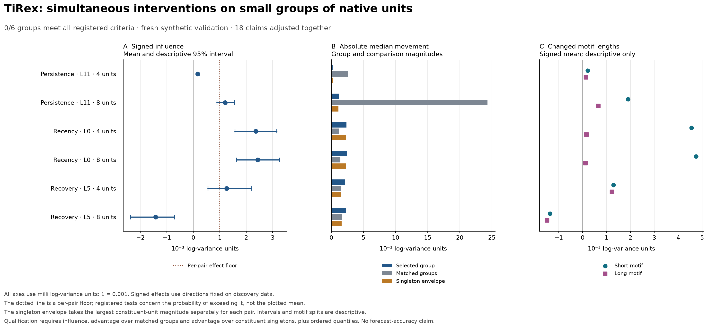

# TiRex native-unit group intervention pilot

**0 of 6 registered groups met all three tests and the quantile-order gate.** Influence passed for 0/6 groups, advantage over matched groups for 0/6, and advantage over the constituent-singleton envelope for 0/6.

This experiment measures how simultaneous replacements of native activations change a fixed TiRex model's forecasts on synthetic histories. It does not measure forecast accuracy, financial calibration, realized returns, or trading value.

The swaps do change forecasts. However, none of the selected groups demonstrates the predeclared combination of consistent influence, superiority to matched groups, and superiority to its constituent units. This does not establish zero influence or reject distributed representation elsewhere in the model.

- The eight-unit recency group moves the median by 0.002439 on average in absolute log-variance units; the per-pair constituent-singleton envelope is already 0.002248.
- The eight-unit persistence controls move forecasts about 19.9 times as much as the selected group. Approximate control matching is documented below.
- The eight-unit recovery group's held-out signed mean is -0.001422, opposite to its discovery-frozen direction.

Joint changes are generally close to the sum of the individual changes under these interventions. Additivity is compatible with distributed coding; it is not evidence that a representation must be localized.



## Registered comparisons

All effect sizes below are in **milli log-variance units**: a value of 1 means 0.001 in the native log-variance forecast. Signed influence uses each group's direction fixed on discovery data. The interval is a descriptive, pointwise 95% paired-bootstrap interval; it is not the registered test.

| Family / layer / size | Signed mean [95% interval] | Influence p, Holm | Matched-group p, Holm | Singleton p, Holm | Crossings | Qualified |
|---|---:|---:|---:|---:|---:|:---:|
| Persistence · L11 · 4 units | 0.167 [0.150, 0.187] | 1 | 1 | 1 | 0 | No |
| Persistence · L11 · 8 units | 1.206 [0.891, 1.541] | 1 | 1 | 1 | 0 | No |
| Recency · L0 · 4 units | 2.359 [1.571, 3.157] | 1 | 1 | 1 | 0 | No |
| Recency · L0 · 8 units | 2.432 [1.639, 3.264] | 1 | 1 | 1 | 0 | No |
| Recovery · L5 · 4 units | 1.263 [0.555, 2.202] | 1 | 1 | 1 | 0 | No |
| Recovery · L5 · 8 units | -1.422 [-2.369, -0.710] | 1 | 1 | 1 | 0 | No |

Each primary comparison uses 32 independent own-family pairs. The strict numerical floor is 0.001 log-variance units. Each of 18 one-sided exact binomial tests asks whether more than half of the generator's pairs exceed its floor; Holm correction covers all 18 claims. These are not tests of a population mean. A qualifying group must pass all three comparisons and have no own-family crossings in baseline, joint, matched-control, or constituent-singleton forecasts.

## Native forecasts and the two swap directions

The native contrast is the untouched donor median minus the untouched recipient median. Recipient and donor columns retain their raw signs; agreement uses the group's discovery-frozen predicted direction. All shifts and contrasts use milli log-variance units.

| Group | Native donor−recipient contrast | Recipient median shift | Donor median shift | Both directions have expected sign |
|---|---:|---:|---:|---:|
| Persistence · L11 · 4 units | -1369.754 | -0.366 | -0.031 | 34.4% |
| Persistence · L11 · 8 units | -1369.754 | 1.611 | -0.801 | 93.8% |
| Recency · L0 · 4 units | 4.035 | -2.321 | 2.398 | 96.9% |
| Recency · L0 · 8 units | 4.035 | -2.420 | 2.444 | 84.4% |
| Recovery · L5 · 4 units | -87.983 | -2.167 | 0.359 | 65.6% |
| Recovery · L5 · 8 units | -87.983 | -1.779 | 1.065 | 0.0% |

A partial-group replacement can disrupt compensating computations, especially if the native input-to-forecast contrast is small. Intervention sensitivity therefore does not establish that this group mediates the original contrast. No effect-to-contrast ratio is used, because a near-zero denominator can make that ratio misleading.

## Effect magnitudes and nonadditivity

| Family / layer / size | Group mean absolute shift | Matched groups | Per-pair singleton envelope | Mean absolute joint-minus-sum | q90−q10 width movement |
|---|---:|---:|---:|---:|---:|
| Persistence · L11 · 4 units | 0.211 | 2.588 | 0.279 | 0.008 | 1.534 |
| Persistence · L11 · 8 units | 1.224 | 24.327 | 1.117 | 0.024 | 6.762 |
| Recency · L0 · 4 units | 2.360 | 1.139 | 2.248 | 0.009 | 1.452 |
| Recency · L0 · 8 units | 2.439 | 1.421 | 2.248 | 0.017 | 1.505 |
| Recovery · L5 · 4 units | 2.077 | 1.518 | 1.549 | 0.067 | 6.557 |
| Recovery · L5 · 8 units | 2.251 | 1.710 | 1.589 | 0.103 | 7.816 |

The singleton envelope is the mean of the maximum constituent-unit magnitude for each pair, after averaging that unit's two swap directions; it is not the magnitude of one globally chosen best singleton. Matched groups average four disjoint matched control groups and both directions. Joint-minus-sum compares the joint median change against the sum of constituent changes, each measured from the same original baseline. Nonadditivity is descriptive and is neither required nor sufficient for qualification. An interval-width change measures a different output from a median log-variance change.

## Approximate control matching

Matching uses three discovery quantities, but it does not make every quantity equal. The table reports control-over-candidate ratios: aggregate RMS Euclidean displacement of the patched input, followed by the minimum and maximum slot-level matching ratios. A displacement ratio below 1 means that control moves its group by less on average. These are descriptive diagnostics, with no post-result exclusions or new pass criteria.

| Group | Input displacement RMS ratios, C1 / C2 / C3 / C4 | Activation-SD slot range | Outgoing-norm slot range | Paired-difference RMS slot range |
|---|---|---:|---:|---:|
| Persistence · L11 · 4 units | 0.972 / 0.967 / 0.893 / 0.890 | 0.940–2.067 | 0.612–1.098 | 0.849–1.281 |
| Persistence · L11 · 8 units | 0.956 / 0.950 / 0.881 / 0.865 | 0.920–2.067 | 0.612–1.147 | 0.804–1.281 |
| Recency · L0 · 4 units | 0.977 / 0.934 / 0.964 / 0.863 | 0.946–1.344 | 0.931–1.222 | 0.738–1.123 |
| Recency · L0 · 8 units | 0.976 / 0.973 / 0.978 / 0.944 | 0.882–1.473 | 0.777–1.222 | 0.708–1.169 |
| Recovery · L5 · 4 units | 0.927 / 0.738 / 1.090 / 0.710 | 0.784–1.559 | 0.921–1.042 | 0.618–1.177 |
| Recovery · L5 · 8 units | 0.935 / 0.795 / 1.058 / 0.757 | 0.784–1.559 | 0.921–1.160 | 0.618–1.177 |

For member RMS differences r and slot matching ratios c, the aggregate ratio is sqrt(sum((r × c)²) / sum(r²)). Some controls therefore apply smaller input displacements, and individual activation-scale matches can also differ materially. An advantage over these controls cannot isolate semantic specificity: perturbation size, covariance, and downstream sensitivity remain alternative explanations. Four-unit rows reuse prefixes of the eight-unit groups, so their matching slots are not independent additional matches. See the [independent matching diagnostic](control_match_review.json).

## Synthetic counterexamples

Every family and both motif lengths are reported below, including off-family responses. These descriptions add no significance claims. Activation contrast averages member donor-minus-recipient differences after applying each member's discovery-frozen sign and dividing by its pooled discovery activation SD. Activation consistency is the fraction of pairs with a positive mean standardized member contrast; it is not a probability of a correct forecast or proof that the group represents only the named concept.

| Group | Evaluated family / motif | Pairs | Signed shift | Absolute shift | Both directions agree | Activation contrast | Activation consistency | Width movement |
|---|---|---:|---:|---:|---:|---:|---:|---:|
| Persistence · L11 · 4 units | persistence/all | 32 | 0.167 | 0.211 | 34.4% | 2.800 | 100.0% | 1.534 |
| Persistence · L11 · 4 units | persistence/long | 18 | 0.137 | 0.173 | 33.3% | 2.892 | 100.0% | 1.673 |
| Persistence · L11 · 4 units | persistence/short | 14 | 0.207 | 0.260 | 35.7% | 2.681 | 100.0% | 1.354 |
| Persistence · L11 · 4 units | recency/all | 32 | -0.007 | 0.010 | 21.9% | 0.119 | 78.1% | 0.087 |
| Persistence · L11 · 4 units | recency/long | 16 | -0.012 | 0.012 | 6.2% | 0.175 | 100.0% | 0.076 |
| Persistence · L11 · 4 units | recency/short | 16 | -0.002 | 0.007 | 37.5% | 0.063 | 56.2% | 0.099 |
| Persistence · L11 · 4 units | recovery/all | 32 | 0.016 | 0.026 | 68.8% | -0.265 | 34.4% | 0.234 |
| Persistence · L11 · 4 units | recovery/long | 14 | 0.013 | 0.031 | 57.1% | -0.428 | 35.7% | 0.424 |
| Persistence · L11 · 4 units | recovery/short | 18 | 0.019 | 0.022 | 77.8% | -0.138 | 33.3% | 0.086 |
| Persistence · L11 · 8 units | persistence/all | 32 | 1.206 | 1.224 | 93.8% | 2.710 | 100.0% | 6.762 |
| Persistence · L11 · 8 units | persistence/long | 18 | 0.663 | 0.694 | 88.9% | 2.558 | 100.0% | 6.047 |
| Persistence · L11 · 8 units | persistence/short | 14 | 1.904 | 1.904 | 100.0% | 2.906 | 100.0% | 7.682 |
| Persistence · L11 · 8 units | recency/all | 32 | 0.012 | 0.051 | 53.1% | 0.119 | 81.2% | 0.157 |
| Persistence · L11 · 8 units | recency/long | 16 | 0.056 | 0.064 | 87.5% | 0.198 | 93.8% | 0.170 |
| Persistence · L11 · 8 units | recency/short | 16 | -0.032 | 0.037 | 18.8% | 0.040 | 68.8% | 0.145 |
| Persistence · L11 · 8 units | recovery/all | 32 | -0.123 | 0.126 | 6.2% | -0.387 | 3.1% | 0.626 |
| Persistence · L11 · 8 units | recovery/long | 14 | -0.104 | 0.112 | 14.3% | -0.526 | 7.1% | 0.933 |
| Persistence · L11 · 8 units | recovery/short | 18 | -0.137 | 0.137 | 0.0% | -0.279 | 0.0% | 0.387 |
| Recency · L0 · 4 units | persistence/all | 32 | -0.206 | 1.080 | 18.8% | 0.305 | 81.2% | 1.746 |
| Recency · L0 · 4 units | persistence/long | 18 | 0.179 | 0.986 | 22.2% | 0.213 | 72.2% | 1.391 |
| Recency · L0 · 4 units | persistence/short | 14 | -0.701 | 1.201 | 14.3% | 0.424 | 92.9% | 2.202 |
| Recency · L0 · 4 units | recency/all | 32 | 2.359 | 2.360 | 96.9% | 0.635 | 50.0% | 1.452 |
| Recency · L0 · 4 units | recency/long | 16 | 0.161 | 0.163 | 93.8% | -0.084 | 0.0% | 0.111 |
| Recency · L0 · 4 units | recency/short | 16 | 4.557 | 4.557 | 100.0% | 1.354 | 100.0% | 2.793 |
| Recency · L0 · 4 units | recovery/all | 32 | -0.081 | 0.416 | 25.0% | -0.375 | 15.6% | 0.658 |
| Recency · L0 · 4 units | recovery/long | 14 | -0.057 | 0.299 | 35.7% | -0.560 | 7.1% | 0.635 |
| Recency · L0 · 4 units | recovery/short | 18 | -0.099 | 0.507 | 16.7% | -0.231 | 22.2% | 0.676 |
| Recency · L0 · 8 units | persistence/all | 32 | -1.048 | 1.775 | 6.2% | 0.402 | 96.9% | 2.733 |
| Recency · L0 · 8 units | persistence/long | 18 | -0.624 | 1.626 | 11.1% | 0.321 | 94.4% | 2.436 |
| Recency · L0 · 8 units | persistence/short | 14 | -1.594 | 1.967 | 0.0% | 0.507 | 100.0% | 3.114 |
| Recency · L0 · 8 units | recency/all | 32 | 2.432 | 2.439 | 84.4% | 0.466 | 50.0% | 1.505 |
| Recency · L0 · 8 units | recency/long | 16 | 0.118 | 0.133 | 68.8% | -0.161 | 0.0% | 0.119 |
| Recency · L0 · 8 units | recency/short | 16 | 4.746 | 4.746 | 100.0% | 1.093 | 100.0% | 2.892 |
| Recency · L0 · 8 units | recovery/all | 32 | -0.112 | 0.494 | 6.2% | -0.004 | 40.6% | 0.855 |
| Recency · L0 · 8 units | recovery/long | 14 | -0.079 | 0.378 | 7.1% | -0.348 | 7.1% | 1.010 |
| Recency · L0 · 8 units | recovery/short | 18 | -0.138 | 0.585 | 5.6% | 0.264 | 66.7% | 0.734 |
| Recovery · L5 · 4 units | persistence/all | 32 | 0.131 | 0.429 | 43.8% | 0.450 | 59.4% | 1.564 |
| Recovery · L5 · 4 units | persistence/long | 18 | -0.177 | 0.336 | 11.1% | -0.201 | 27.8% | 1.706 |
| Recovery · L5 · 4 units | persistence/short | 14 | 0.528 | 0.549 | 85.7% | 1.287 | 100.0% | 1.382 |
| Recovery · L5 · 4 units | recency/all | 32 | -0.036 | 0.130 | 31.2% | -0.371 | 12.5% | 0.355 |
| Recovery · L5 · 4 units | recency/long | 16 | -0.010 | 0.083 | 18.8% | -0.251 | 18.8% | 0.286 |
| Recovery · L5 · 4 units | recency/short | 16 | -0.062 | 0.177 | 43.8% | -0.492 | 6.2% | 0.424 |
| Recovery · L5 · 4 units | recovery/all | 32 | 1.263 | 2.077 | 65.6% | 1.964 | 100.0% | 6.557 |
| Recovery · L5 · 4 units | recovery/long | 14 | 1.226 | 3.001 | 42.9% | 2.092 | 100.0% | 9.628 |
| Recovery · L5 · 4 units | recovery/short | 18 | 1.292 | 1.359 | 83.3% | 1.864 | 100.0% | 4.168 |
| Recovery · L5 · 8 units | persistence/all | 32 | 0.001 | 0.390 | 43.8% | 0.214 | 56.2% | 1.666 |
| Recovery · L5 · 8 units | persistence/long | 18 | 0.218 | 0.405 | 66.7% | -0.178 | 22.2% | 1.928 |
| Recovery · L5 · 8 units | persistence/short | 14 | -0.278 | 0.370 | 14.3% | 0.720 | 100.0% | 1.330 |
| Recovery · L5 · 8 units | recency/all | 32 | 0.043 | 0.141 | 40.6% | -0.138 | 28.1% | 0.489 |
| Recovery · L5 · 8 units | recency/long | 16 | 0.006 | 0.091 | 37.5% | -0.311 | 0.0% | 0.402 |
| Recovery · L5 · 8 units | recency/short | 16 | 0.079 | 0.191 | 43.8% | 0.035 | 56.2% | 0.576 |
| Recovery · L5 · 8 units | recovery/all | 32 | -1.422 | 2.251 | 0.0% | 1.637 | 100.0% | 7.816 |
| Recovery · L5 · 8 units | recovery/long | 14 | -1.490 | 3.363 | 0.0% | 1.797 | 100.0% | 11.594 |
| Recovery · L5 · 8 units | recovery/short | 18 | -1.370 | 1.386 | 0.0% | 1.513 | 100.0% | 4.878 |

## What the design establishes

Candidate groups contain four or eight nested units from family layers fixed before this experiment using the prior single-unit pilot's results. Discovery data determine unit ranking, four disjoint matched control groups, and forecast directions; fresh validation data determine the reported results. Group members are replaced simultaneously from the same untouched paired donor state at context token 63. Layer, unit and token indices are zero-based. Tests check hook cleanup, no-op identity, normalization, batching and equivalence of a one-member group to the frozen scalar adapter.

The synthetic pairs share their histogram and terminal value, but recent means, slopes, autocorrelation, and other temporal features can differ. Matching control activation scales, projection norms and donor-displacement magnitudes does not match covariance or all downstream influences. Natural donor coordinates can create an off-manifold hybrid state. Passing all criteria supports aggregate influence for this group under this intervention; it does not identify an exclusive concept, establish native-basis superiority over rotated representations, or characterize the whole model.

## Research sharing

This is a reproducible case study of hypothesis testing with an AI-assisted research harness: prewritten contracts, a pinned checkpoint, fresh synthetic splits, frozen selection rules, matched interventions and explicit negative results. The useful claim is that the experiment tests representation hypotheses through forecast interventions with controls. It makes no novelty claim, exclusive-concept claim, or proof of Goodfire's broader hypothesis.

The model is credited to Podest and colleagues, [*TiRex-2: Generalizing TiRex to Multivariate Data and Streaming*](https://arxiv.org/abs/2607.01204), as identified by the [official model documentation](https://nx-ai.github.io/tirex-2/introduction/); this study extends their released checkpoint with intervention experiments and does not replicate their forecasting benchmarks.

This group study follows the [earlier single-unit intervention pilot](../tirex_intervention_pilot/REPORT.md) with fresh synthetic discovery and validation draws.

[Goodfire's *Neural Networks Are Already Clean*](https://already-clean.goodfire.com/) is an informal working-hypothesis essay motivating direct study of native mechanisms and attempts to challenge explanations.

[Zhang and Nanda, *Towards Best Practices of Activation Patching in Language Models: Metrics and Methods*](https://arxiv.org/abs/2309.16042) shows that methodological choices can change activation-patching conclusions, motivating explicit metrics and controls here.

## Verification and reproduction

The tests-first implementation and separately implemented verifier were developed with AI assistance in this repository; this is internal verification, with no external replication or peer review claimed.

Pre-execution checks passed 37 new synthetic contract tests and 19 prior-adapter regression tests, for 56 tests in total. Test success validates these software contracts; it does not by itself validate a scientific mechanism.

The report reads `summary.json` and `protocol.json` without changing them. The run directory also contains its source/checkpoint receipts, selected groups and directions, raw forecasts, activation records, and instrument checks. Inspect those records when assessing the reported findings; the report receipt records the exact summary and protocol hashes used to create this figure and text.

Evidence: [registered protocol](protocol.json), [full numerical results](summary.json), [frozen group selection](group_lock.json), [group instrumentation](group_instrumentation.json), [prewritten tests and receipts](tests_first/), and [independent verification](independent_verification.json).

Run from the repository root in the project environment. A model rerun needs the pinned checkpoint and a new output directory. The prior pilot supplies context records for the disjointness check. The saved run's tests-first and execution receipts document this run, rather than being regenerated by these commands.

```bash
python -m unittest tests.test_tirex_group_pilot tests.test_tirex_group_adapter tests.test_tirex_group_run_helpers tests.test_tirex_intervention_adapter
python -m src.tirex_group_run --protocol tirex_group_pilot.json --output reports/tirex_group_pilot/new_run --prior-run reports/tirex_intervention_pilot
python scripts/verify_tirex_group_pilot.py --run-dir reports/tirex_group_pilot/new_run --source-root . --prior-run reports/tirex_intervention_pilot --output reports/tirex_group_pilot/new_run/independent_verification.json
python -m src.tirex_group_report --run-dir reports/tirex_group_pilot/new_run
```

Saved run duration: 349.2 seconds.
