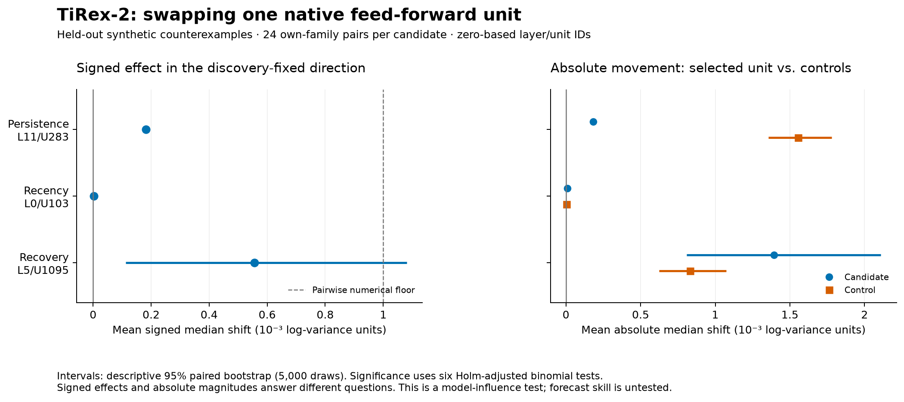

# TiRex-2 native-unit activation swaps: synthetic pilot

Completed 2026-10-21T22:27:29.654221+00:00. Status: **COMPLETED_SYNTHETIC_INTERVENTION_PILOT**.

**None of the selected units passed the registered influence criterion** on its own synthetic family. 0 of 3 passed the matched-control advantage criterion. These are tests of local model influence under a specified synthetic generator; they do not establish a uniquely represented concept or better forecasts.

- **Persistence L11/U283:** the activation contrast had its discovery sign in 24/24 new pairs. Mean absolute forecast-median movement was 0.0001815756, versus 0.001555689 for matched controls (log-variance units).
- **Recency L0/U103:** the activation contrast had its discovery sign in 15/24 new pairs. Mean absolute forecast-median movement was 9.397666e-06, versus 2.935529e-06 for matched controls (log-variance units). The mean oriented activation contrast changed sign between short (2.42404 discovery SD) and long (-0.1188801) motifs. The mean signed forecast effect changed sign between short (1.144409e-05) and long (-2.473593e-06) motifs.
- **Recovery L5/U1095:** the activation contrast had its discovery sign in 24/24 new pairs. Mean absolute forecast-median movement was 0.001393676, versus 0.0008320063 for matched controls (log-variance units). The mean signed forecast effect changed sign between short (0.00101161) and long (-8.177757e-05) motifs.



## What was tested

The pinned `NX-AI/TiRex-2` checkpoint `05e5b26db52bfb256f1ae1bdf785589850482de3` received 2048-point synthetic log-variance histories and produced 1-step q10/q50/q90 forecasts. No market prices, returns, future outcomes, or real-market prediction targets were used.

Discovery used 12 independent pairs in each of three families; validation used 24 new pairs per family. Each recipient/donor pair contains exactly the same multiset and final observation, with context mean −9 and population SD 0.6. The permutation changes temporal organization. Validation changes motif duration, amplitude and noise and includes both short and long versions, challenging explanations formed on discovery.

| Family | Discovery contrast |
| --- | --- |
| Persistence | Alternating low/high values versus the same values grouped into runs. |
| Recency | The same positive burst placed earlier versus later, followed by a common quiet tail. |
| Recovery | A noisy rising ramp versus the same values in reverse order. |

Candidate selection searched layers [0, 5, 11] only, using absolute standardized donor-minus-recipient activation contrast. One unique unit per family was retained. Four control units in the same layer were matched by pooled activation SD and outgoing-weight norm. Unit identities, controls and the expected forecast-shift sign were fixed using discovery before any validation forecast. All layer and unit IDs are zero-based.

Each intervention replaced one gated feed-forward scalar at token 63 with its paired donor value, in both directions. The hook is immediately before the feed-forward output projection. The model was not retrained.

## Instrumentation and normalization

Overall instrumentation gate: **PASS**. Forecasts from the capture hook are checked against the unhooked public forecast wrapper; same-value swaps, reversed batch order and singleton versus batched execution are also checked. Positive affine transformations of each entire input test invariance of normalized activations and corresponding equivariance of forecasts in the original units.

| Check | Maximum forecast absolute error | Maximum activation relative error | Result |
| --- | ---: | ---: | --- |
| unhooked | 0 | not captured | PASS |
| self_swap_layer0 | 0 | 0 | PASS |
| self_swap_layer5 | 0 | 0 | PASS |
| self_swap_layer11 | 0 | 0 | PASS |
| batch_reversal | 0 | 0 | PASS |
| singleton_vs_batch | 0 | 0 | PASS |
| affine_0 | 3.33786e-06 | 9.402633e-06 | PASS |
| affine_1 | 3.814697e-06 | 1.038611e-05 | PASS |

The protocol tolerances were 0.0001 for forecast absolute error and 0.0001 for activation relative error. The instrumentation baseline had 0 quantile crossings. The normalization result limits any claim that a hidden scalar directly measures absolute volatility: global positive affine changes can leave normalized activations almost unchanged.

## Held-out own-family intervention results

The signed effect is the discovery-fixed sign multiplied by half the recipient median change minus the donor median change. The influence null says that at most half of generated pairs exceed the strict +0.001 log-variance floor. Control advantage is the candidate's mean absolute median change across the two directions minus the corresponding average across four controls. Its null uses the same strict floor. Exact one-sided binomial p-values are adjusted together by Holm over all six claims. Bootstrap mean intervals are descriptive, pointwise 95% intervals from 5,000 pair-resampling draws; whether an interval includes zero is not the registered decision rule.

| Candidate / family | Expected recipient sign | Signed mean [95% interval] | Influence successes | Holm p | Influence pass |
| --- | ---: | --- | ---: | ---: | --- |
| L11/U283 / persistence | -1 | 0.0001815756 [0.000170618, 0.0001914203] | 0/24 | 1 | FALSE |
| L0/U103 / recency | -1 | 2.165635e-06 [-3.060699e-06, 7.450581e-06] | 0/24 | 1 | FALSE |
| L5/U1095 / recovery | -1 | 0.0005560319 [0.000111714, 0.001081012] | 5/24 | 1 | FALSE |

| Candidate | Absolute median movement | Control movement | Advantage mean [95% interval] | Advantage successes | Holm p | Advantage pass |
| --- | ---: | ---: | --- | ---: | ---: | --- |
| L11/U283 | 0.0001815756 | 0.001555689 | -0.001374113 [-0.001604793, -0.001172597] | 0/24 | 1 | FALSE |
| L0/U103 | 9.397666e-06 | 2.935529e-06 | 6.462137e-06 [1.817817e-06, 1.180718e-05] | 0/24 | 1 | FALSE |
| L5/U1095 | 0.001393676 | 0.0008320063 | 0.0005616695 [0.0001180946, 0.001110395] | 4/24 | 1 | FALSE |

All shifts above are in log-variance units. The 0.001 numerical floor corresponds to approximately 0.1% multiplicative variance change, not a 0.1 percentage-point return, and is not a threshold of financial materiality. Absolute movement can be nonzero even when the signed effect cancels or runs against the discovery direction.

| Candidate | Native donor-minus-recipient median contrast | Mean recipient median shift | Mean donor median shift | Both directions expected sign | Mean absolute interval-width change | Candidate/base/control crossings |
| --- | ---: | ---: | ---: | ---: | ---: | --- |
| L11/U283 | -1.457438 | -0.0002379417 | 0.0001252095 | 100.0% | 8.768837e-05 | 0/0/0 |
| L0/U103 | -6.198883e-06 | -2.344449e-06 | 1.986821e-06 | 25.0% | 3.472964e-05 | 0/0/0 |
| L5/U1095 | -0.1061741 | -0.001582026 | -0.0004699628 | 29.2% | 0.004912148 | 0/0/0 |

Interval width means q90 minus q10 of the forecast log-variance distribution. A width change is a change in uncertainty about the model's predicted log variance, separately from a change in its median level. Crossings are counted without quantile rearrangement, and any own-family candidate, baseline or control crossing blocks a pass.

## Counterexamples and off-family effects

Every candidate is evaluated on every family. Short and long variants are shown separately. The signed values use the candidate's discovery-fixed forecast direction. These are descriptive checks, with no secondary significance declarations or selection of favorable variants.

| Candidate | Test family | Relationship | All n / signed mean | Short n / signed mean | Long n / signed mean |
| --- | --- | --- | --- | --- | --- |
| L11/U283 | persistence | own family | 24 / 0.0001815756 | 14 / 0.0001968827 | 10 / 0.0001601458 |
| L11/U283 | recency | other family | 24 / 1.033147e-06 | 8 / -1.072884e-06 | 16 / 2.086163e-06 |
| L11/U283 | recovery | other family | 24 / -4.331271e-06 | 14 / 3.40598e-08 | 10 / -1.044273e-05 |
| L0/U103 | persistence | other family | 24 / 1.241763e-06 | 14 / -1.004764e-06 | 10 / 4.386902e-06 |
| L0/U103 | recency | own family | 24 / 2.165635e-06 | 8 / 1.144409e-05 | 16 / -2.473593e-06 |
| L0/U103 | recovery | other family | 24 / -3.317992e-06 | 14 / -4.291534e-06 | 10 / -1.955032e-06 |
| L5/U1095 | persistence | other family | 24 / 2.376238e-05 | 14 / 5.977494e-06 | 10 / 4.866123e-05 |
| L5/U1095 | recency | other family | 24 / 4.168351e-05 | 8 / 5.763769e-05 | 16 / 3.370643e-05 |
| L5/U1095 | recovery | own family | 24 / 0.0005560319 | 14 / 0.00101161 | 10 / -8.177757e-05 |

The activation explanation is challenged separately from forecast influence. The next table uses donor-minus-recipient activation difference, oriented by its discovery sign and divided by the pooled discovery activation SD. Each cell is **mean standardized contrast; positive-sign count / pair count**. A stable positive contrast supports generalization of a response pattern; a large response on another family weakens any claim that the label is exclusive. These comparisons are descriptive and add no significance claims.

| Candidate | Test family | All contrast; sign count | Short contrast; sign count | Long contrast; sign count |
| --- | --- | --- | --- | --- |
| L11/U283 | persistence | 2.705116; 24/24 | 2.979982; 14/14 | 2.320303; 10/10 |
| L11/U283 | recency | 0.0276998; 17/24 | -0.03158764; 4/8 | 0.05734352; 13/16 |
| L11/U283 | recovery | -0.09175744; 9/24 | 0.00528675; 7/14 | -0.2276193; 2/10 |
| L0/U103 | persistence | 0.103679; 12/24 | -0.01454144; 7/14 | 0.2691876; 5/10 |
| L0/U103 | recency | 0.7287599; 15/24 | 2.42404; 7/8 | -0.1188801; 8/16 |
| L0/U103 | recovery | 0.06762657; 11/24 | 0.3987971; 8/14 | -0.3960122; 3/10 |
| L5/U1095 | persistence | 0.1123479; 14/24 | -0.07355363; 4/14 | 0.3726099; 10/10 |
| L5/U1095 | recency | -0.2792614; 9/24 | -0.9502942; 0/8 | 0.05625497; 9/16 |
| L5/U1095 | recovery | 2.805909; 24/24 | 3.123216; 14/14 | 2.361679; 10/10 |

Full activation-counterexample summaries are saved in [activation_counterexamples.json](activation_counterexamples.json).

## Limits of the interpretation

- These histories are synthetic log variance, not prices or returns. No realized future truth is available, so forecast accuracy, calibration, portfolio returns and trading alpha were not tested.
- Within-pair global distributions and the last value are matched. Recent means, HAR-style volatility summaries, slopes and autocorrelation are not all matched, so a motif label does not uniquely identify the computation being represented.
- Selection searched three preselected layers and one token. This does not survey every unit, exclude distributed mechanisms, or establish superiority of native units over rotated representations.
- The transplanted scalar is observed in a natural forward pass, but the resulting hybrid state can be off manifold. An intervention effect establishes local model sensitivity under this operation, not concept exclusivity or a complete causal account of forecasting.
- Validation p-values are conditional on the declared synthetic generator and its mixture of short and long motifs. They are not population claims about financial histories.
- Small effects below the predeclared floor can be measurable. Failure of the criterion does not prove that a unit has exactly zero influence; a passing result does not by itself make its influence economically meaningful.

## Verification and reproduction

**47 tests passed** in the saved aggregate test log. Test-first receipts preserve the initial pre-implementation failures.

See the [aggregate test log](tests_first/ALL_TESTS_GREEN.log) and [independent reconstruction receipt](independent_verification.json). The independent checker reconstructs saved summaries from raw interventions without rerunning TiRex.

The checkpoint weights SHA256 is `184b160ffbe4c01a26beeba14015ff3507c7497e1f3577114187bbc1d19fcac1`. Execution used Python 3.11.7, TiRex-2 0.2.1, PyTorch 2.13.0, cpu and 4 threads. Compilation, flex attention and both test-time augmentation options were disabled. [Model metadata](model_metadata.json) includes source hashes and version details.

The [protocol](protocol.json), [pre-execution hashes](pre_execution.json), [candidate lock](candidate_lock.json), [instrumentation](instrumentation.json), [summary](summary.json), and raw discovery/validation arrays are retained. The report reconstructs absolute movement from the saved validation swaps and checks pair identities, counts and candidate-lock consistency before plotting.

To repeat from the repository environment with the pinned checkpoint available:

```sh
python -m src.tirex_intervention_run --protocol tirex_intervention_pilot.json --output reports/tirex_intervention_pilot/new_run
python -m src.tirex_intervention_report --run-dir reports/tirex_intervention_pilot/new_run
python scripts/verify_tirex_intervention_pilot.py --run-dir reports/tirex_intervention_pilot/new_run --source-root . --output reports/tirex_intervention_pilot/new_run/independent_verification.json
```

The run output must be a new directory. Existing run output is not overwritten. The report command reads completed outputs and does not load or run TiRex.
