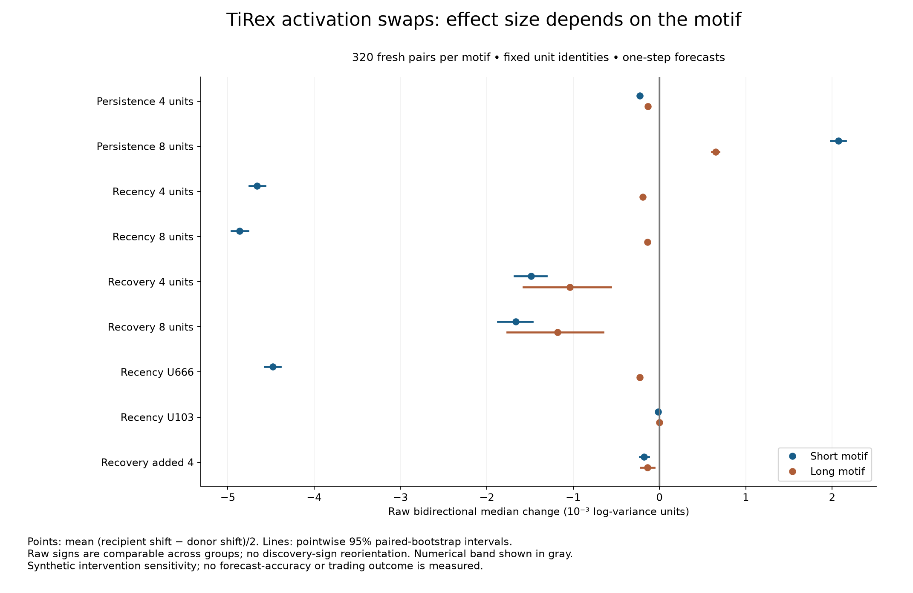

# TiRex activation swaps: stratified follow-up and reassessment

Completed 2026-10-22. This study follows a critique of the original pooled group-pilot criterion. Its protocol and intervention identities were fixed before fresh calibration; the numerical band, sensitivity estimates, random reference sets and recent-mean fit were frozen before validation. The questions were informed by prior results, so this is a follow-up, not an independent discovery.

## What the experiments show

The original “0/6” headline was too broad. It summarized a restrictive composite probability criterion, not a test of whether the selected units affected forecasts. The [retrospective reassessment](../tirex_group_pilot/REASSESSMENT.md) supplies all 18 raw p-values and counts, discovery effects, motif strata and power, while preserving the original artifacts.

- **Recency L0/U666:** fresh raw mean effects are -4.477 milli for short motifs and -0.228 milli for long motifs. The named unit was selected in the group pilot; the earlier single-unit pilot selected **L0/U103**, which is evaluated separately here. The short-motif four- and eight-unit means are −4.659 and −4.861 milli, only slightly larger in magnitude than U666 alone. On long motifs, the groups attenuate the singleton effect. This comparison is not a causal percentage attribution.
- **Recovery L5:** compare the four-unit prefix, added four units and full eight in the same raw sign convention below. The original +1.263/−1.422 milli chart values used different discovery orientations; both raw validation effects were negative. Adding units did not flip that raw sign. In the fresh run, the prefix, added four and full eight all have negative mean effects in both motifs, with heterogeneous pair-level responses, especially for long motifs.
- **Persistence L11:** the selected groups have measurable local intervention effects. On the fixed reference subset, all 19 random four-unit sets and most random eight-unit sets move forecasts more than the corresponding selected group. Neither the old four comparison sets nor this small reference sample establish global layer sensitivity or forecast irrelevance.



All milli quantities in this report equal 0.001 native log-variance units. A numerical effect is not a percentage-point return, a forecast-accuracy gain or a measure of economic value.

## Effects, calibration sensitivity and raw tests

The primary effect is **(recipient median shift − donor median shift)/2**, without discovery-based sign multiplication. Short and long motifs are separate estimands. Each row has 320 independent synthetic pairs. Calibration used 32 separate pairs per cell under the same generator law. Intervals are descriptive, pointwise 95% paired-bootstrap intervals, not simultaneous intervals.

| Intervention / motif | Calibration mean (milli) | Validation mean [95% CI] (milli) | Raw p | Holm18 p | Approx. MDE80 (milli) | + / − / numerical-neutral |
|---|---:|---:|---:|---:|---:|---|
| Persistence 4 units / short | -0.238 | -0.227 [-0.236 / -0.219] | 1.817e-157 | 2.544e-156 | 0.024 | 0 / 319 / 1 |
| Persistence 4 units / long | -0.132 | -0.135 [-0.139 / -0.130] | 5.938e-163 | 8.907e-162 | 0.020 | 0 / 319 / 1 |
| Persistence 8 units / short | 2.128 | 2.071 [1.982 / 2.158] | 1.051e-140 | 1.261e-139 | 0.206 | 320 / 0 / 0 |
| Persistence 8 units / long | 0.675 | 0.650 [0.609 / 0.692] | 5.167e-97 | 5.167e-96 | 0.113 | 303 / 16 / 1 |
| Recency 4 units / short | -4.680 | -4.659 [-4.749 / -4.569] | 6.353e-240 | 1.143e-238 | 0.220 | 0 / 320 / 0 |
| Recency 4 units / long | -0.193 | -0.192 [-0.201 / -0.182] | 1.986e-116 | 2.184e-115 | 0.031 | 0 / 315 / 5 |
| Recency 8 units / short | -4.878 | -4.861 [-4.955 / -4.763] | 1.362e-237 | 2.316e-236 | 0.235 | 0 / 320 / 0 |
| Recency 8 units / long | -0.130 | -0.139 [-0.149 / -0.129] | 2.172e-76 | 1.955e-75 | 0.031 | 14 / 297 / 9 |
| Recovery 4 units / short | -1.832 | -1.484 [-1.679 / -1.309] | 5.078e-42 | 3.554e-41 | 0.362 | 34 / 280 / 6 |
| Recovery 4 units / long | -1.311 | -1.039 [-1.576 / -0.564] | 7.96e-05 | 0.0002388 | 0.743 | 115 / 205 / 0 |
| Recovery 8 units / short | -2.071 | -1.662 [-1.871 / -1.470] | 2.192e-44 | 1.753e-43 | 0.388 | 30 / 287 / 3 |
| Recovery 8 units / long | -1.577 | -1.178 [-1.762 / -0.651] | 3.679e-05 | 0.0001471 | 0.816 | 113 / 206 / 1 |
| Recency U666 / short | -4.500 | -4.477 [-4.570 / -4.389] | 2.57e-237 | 4.113e-236 | 0.193 | 0 / 320 / 0 |
| Recency U666 / long | -0.233 | -0.228 [-0.237 / -0.219] | 3.429e-146 | 4.458e-145 | 0.029 | 0 / 320 / 0 |
| Recency U103 / short | -0.018 | -0.017 [-0.020 / -0.014] | 2.751e-06 | 1.376e-05 | 0.017 | 9 / 147 / 164 |
| Recency U103 / long | 0.001 | -0.002 [-0.004 / 0.001] | 1 | 1 | 0.012 | 47 / 52 / 221 |
| Recovery added 4 / short | -0.249 | -0.177 [-0.225 / -0.124] | 4.644e-10 | 2.787e-09 | 0.071 | 61 / 249 / 10 |
| Recovery added 4 / long | -0.274 | -0.136 [-0.217 / -0.061] | 0.001954 | 0.003908 | 0.149 | 126 / 188 / 6 |

The frozen numerical band is **±9.53674316e-06 log-variance units** (0.00954 milli). Maximum observed calibration jitter was 0; maximum float32 spacing was 9.53674316e-07. The rule uses ten times the larger quantity. Ten is a predeclared conservative multiplier; this is a resolution band, not a scientific or economic materiality margin. Repeatability in this deterministic execution is not uncertainty across trained-model seeds.

The two-sided Student t procedure tests whether the population mean lies outside the numerical band, with Holm adjustment across 18 claims. Its sampling-distribution approximation assumes independent synthetic pairs and a sufficiently regular mean at n=320; it is not distribution-free. The sign counts retain numerical-neutral cases and show sign prevalence, without implying that the mean magnitude is typical. Zero sample variance uses the explicitly declared deterministic convention. No group-superiority or semantic-selectivity verdict is attached to this test.

The long-motif recovery mean is sensitive to large individual responses. A [post-result descriptive check](POSTRESULT_SENSITIVITY.md) reports medians, quantiles and the consequence of omitting the largest absolute effects. For the eight-unit group, the mean is −1.178 milli and the median −0.701 milli; omitting the 16 largest absolute effects (5% of pairs) changes the mean to −0.386 milli. This outcome-dependent omission is a sensitivity diagnostic, not a replacement estimate or confirmatory test. All 320 pairs remain in every primary result.

MDE80 is a **planning sensitivity estimate**, using calibration standard deviation and a normal approximation at the conservative first-step Bonferroni threshold: tau + (z[1−0.05/(2×18)] + z[0.8]) × calibration SD / sqrt(320). It assumes calibration variance transfers; it is not retrospectively calculated power or a guarantee.

The old majority-exceedance test needed 25/32 at the first Holm step and a true exceedance probability about 0.821 for 80% power. There is no distribution-free minimum detectable log-variance mean for that binary endpoint. Increasing sample size alone would not fix a mixture whose true exceedance probability is 0.5. Holm remains valid under dependent tests; dependence can make it conservative.

## Individual directions and quantile outcomes

Median log variance was retained as the central forecast quantity addressed by the earlier study. q10, q90 and interval width remain separately visible below. Without realized future targets there is no proper-score or calibration test; changing an interval is not evidence that uncertainty estimates became better.

| Intervention / motif | Recipient q50 shift | Donor q50 shift | q10 effect | q90 effect | Mean absolute width movement | Baseline / intervention crossings |
|---|---:|---:|---:|---:|---:|---|
| Persistence 4 units / short | -0.488 | -0.034 | 0.410 | -0.997 | 1.407 | 0 / 0 |
| Persistence 4 units / long | -0.301 | -0.032 | 0.571 | -0.944 | 1.514 | 0 / 0 |
| Persistence 8 units / short | 2.954 | -1.188 | 2.029 | -5.728 | 7.757 | 0 / 0 |
| Persistence 8 units / long | 0.744 | -0.556 | 1.186 | -4.785 | 5.971 | 0 / 0 |
| Recency 4 units / short | -4.478 | 4.840 | -5.583 | -4.400 | 2.395 | 0 / 0 |
| Recency 4 units / long | -0.180 | 0.203 | -0.253 | -0.146 | 0.166 | 0 / 0 |
| Recency 8 units / short | -4.737 | 4.984 | -5.728 | -4.585 | 2.514 | 0 / 0 |
| Recency 8 units / long | -0.139 | 0.139 | -0.183 | -0.128 | 0.151 | 0 / 0 |
| Recovery 4 units / short | -2.461 | 0.507 | -0.068 | -2.806 | 4.814 | 0 / 0 |
| Recovery 4 units / long | -3.975 | -1.897 | 2.679 | -5.232 | 13.317 | 0 / 0 |
| Recovery 8 units / short | -2.364 | 0.960 | -0.615 | -2.657 | 5.792 | 0 / 0 |
| Recovery 8 units / long | -3.541 | -1.184 | 0.870 | -4.243 | 15.900 | 0 / 0 |
| Recency U666 / short | -4.361 | 4.593 | -5.300 | -4.273 | 2.123 | 0 / 0 |
| Recency U666 / long | -0.201 | 0.256 | -0.278 | -0.207 | 0.112 | 0 / 0 |
| Recency U103 / short | -0.008 | 0.027 | -0.010 | -0.037 | 0.049 | 0 / 0 |
| Recency U103 / long | -0.003 | 0.000 | -0.000 | -0.006 | 0.036 | 0 / 0 |
| Recovery added 4 / short | 0.071 | 0.425 | -0.534 | 0.144 | 1.444 | 0 / 0 |
| Recovery added 4 / long | 0.392 | 0.665 | -1.810 | 1.114 | 4.083 | 0 / 0 |

## Random groups as a descriptive reference

Nineteen uniform eight-unit draws per layer, each with a nested four-unit prefix, replace the earlier approximate matching comparison. Draws exclude the original top eight units and U103 in layer 0; each draw has distinct members, but draws may overlap. All comparisons below use the **same fixed first 16 validation pairs per motif**, not all 320. This is a small descriptive reference distribution. A selected candidate is not exchangeable with these random sets, so ranks are not randomization p-values. There is no claim of matched downstream sensitivity or a binding proxy-match tolerance.

| Group / motif | Candidate absolute movement | Random 10th / median / 90th | Random sets ≥ candidate / 19 | Candidate displacement | Random displacement median |
|---|---:|---|---:|---:|---:|
| Persistence 4 units / short | 0.292 | 1.224 / 4.343 / 10.682 | 19/19 | 3.366 | 0.961 |
| Persistence 4 units / long | 0.175 | 0.830 / 3.999 / 9.195 | 19/19 | 3.589 | 0.932 |
| Persistence 8 units / short | 2.112 | 1.913 / 9.687 / 19.031 | 16/19 | 5.217 | 1.673 |
| Persistence 8 units / long | 0.646 | 0.735 / 7.772 / 17.078 | 18/19 | 4.969 | 1.838 |
| Recency 4 units / short | 4.541 | 0.006 / 0.084 / 1.212 | 0/19 | 0.353 | 0.057 |
| Recency 4 units / long | 0.195 | 0.001 / 0.017 / 0.089 | 0/19 | 0.025 | 0.010 |
| Recency 8 units / short | 4.683 | 0.012 / 0.291 / 2.005 | 0/19 | 0.361 | 0.092 |
| Recency 8 units / long | 0.152 | 0.002 / 0.046 / 0.280 | 3/19 | 0.029 | 0.013 |
| Recovery 4 units / short | 1.766 | 0.230 / 0.402 / 1.204 | 0/19 | 0.237 | 0.082 |
| Recovery 4 units / long | 5.314 | 0.234 / 0.590 / 1.491 | 0/19 | 0.377 | 0.078 |
| Recovery 8 units / short | 2.002 | 0.354 / 0.765 / 1.388 | 1/19 | 0.258 | 0.138 |
| Recovery 8 units / long | 5.537 | 0.364 / 0.859 / 2.122 | 0/19 | 0.404 | 0.118 |

Input displacement is in native activation units; output movement is in milli log variance. The random distribution does not equalize activation displacement, covariance, downstream sensitivity or distance from natural joint states. It describes these chosen interventions; it does not identify a global property of layer 11.

## Recovery dose response

At alpha, each selected activation is replaced by original + alpha × (original donor − original). Alpha 1 is the donor swap, alpha 2 extrapolates beyond it. The eight singletons, prefix four, added four and all eight are tested on the fixed 16-pair-per-motif subset. The next table pools that 32-pair descriptive subset; motif-specific shifts and every raw forecast are also saved. No interaction significance claim is made.

| Recovery group | Alpha | Mean absolute median movement | Mean absolute joint−sum | Mean absolute deviation from alpha×unit-dose effect |
|---|---:|---:|---:|---:|
| Recovery 4 units | 0.25 | 0.916 | 0.00679 | 0.03671 |
| Recovery 4 units | 0.5 | 1.811 | 0.02682 | 0.04911 |
| Recovery 4 units | 1 | 3.540 | 0.10765 | 0.00000 |
| Recovery 4 units | 2 | 6.739 | 0.42978 | 0.39697 |
| Recovery 8 units | 0.25 | 0.977 | 0.00972 | 0.04680 |
| Recovery 8 units | 0.5 | 1.930 | 0.03876 | 0.06248 |
| Recovery 8 units | 1 | 3.769 | 0.15517 | 0.00000 |
| Recovery 8 units | 2 | 7.175 | 0.62013 | 0.49753 |
| Recovery added 4 | 0.25 | 0.187 | 0.00145 | 0.00187 |
| Recovery added 4 | 0.5 | 0.373 | 0.00376 | 0.00235 |
| Recovery added 4 | 1 | 0.743 | 0.01393 | 0.00000 |
| Recovery added 4 | 2 | 1.474 | 0.05627 | 0.01915 |

For the eight-unit group, mean absolute joint−sum grows from 0.00972 milli at alpha 0.25 to 0.62013 milli at alpha 2; the latter dose also departs from twice the unit-dose effect by 0.49754 milli on average. This dose dependence is compatible with ordinary local curvature. Small residuals are compatible with local linearization. Raising alpha does not guarantee leaving the linear regime, and extrapolation can create more unusual hybrid states. Additivity does not establish or reject superposition. The raw dose summaries store original donor displacement; actual intervention displacement is alpha times that quantity.

## Does U666 approximate a recent-mean readout?

A two-parameter linear model (intercept and slope) predicts L0/U666 activation from the arithmetic mean of the last 32 raw observations. It was fitted on calibration recency histories only, using both motifs and both sides, then frozen. Reported R² is out of sample; the paired-difference R² additionally checks donor−recipient changes.

| Validation motifs | Pairs | Activation-level R² | Paired activation-difference R² |
|---|---:|---:|---:|
| all | 640 | 0.903 | 0.918 |
| short | 320 | 0.904 | -0.772 |
| long | 320 | -0.966 | 0.499 |

The pooled paired-difference R² is 0.918, but short-motif difference R² is -0.772 and long-motif level R² is -0.966. This does not establish a uniform linear recent-mean explanation. A model can explain broad differences between motifs or between recipient and donor histories while failing to explain variation among cases within a motif. Negative held-out R² means the frozen surrogate has greater squared error than the constant validation mean; it is evidence against this particular surrogate, not against all linear or temporal-summary explanations.

The short motif places all 19 burst observations in the final 32-observation patch; the long motif leaves only one burst observation there, followed by 30 quiet observations and the common endpoint. That motivates this bounded alternative explanation. The long case is not mathematically null: its native forecast contrast was nonzero in the earlier run. A high R² here would support a local surrogate under this generator, not prove the unit globally computes a linear recent mean. A low R² rejects only this one-feature surrogate.

## What a unit and a forecast mean here

A unit is one of **1,408 gated feed-forward intermediate coordinates**, zᵢ = SiLU(W_gate h)ᵢ × (W_up h)ᵢ, immediately before the down projection at `stack[layer].time_mixer.ffn.proj_down`. It is neither a residual-stream coordinate nor an sLSTM/mLSTM cell state. Layer 0 already follows nonlinear embedding, normalization and recurrent processing. Its early location alone does not establish a linear readout.

There are 64 observed 32-sample patches in the 2,048-observation context. Zero-based **token 63** is the final observed patch; its output supplies the first predicted observation. The horizon is **one synthetic log-variance observation**. This is not an experiment varying the forecasting horizon. Full-history scaling and arcsinh transforms are inverted, and the public wrapper’s uncertainty processing is retained. Median and quantile changes are therefore measured in restored log-variance units.

Elementwise gating gives this intermediate basis an architectural role, but gated transformer feed-forward networks also have elementwise coordinates. No rotated-basis comparison was run. These experiments do not prove native-basis superiority or a general theory of neural-network interpretability.

## Provenance, limits and reproduction

**75 tests passed:** 56 new generator, statistics, runner, readout and audit contracts, plus 19 unchanged prior-adapter regression tests. Tests validate these software contracts, not the scientific interpretation of the model. The second implementation passed 12,664 numerical checks against saved artifacts; it does not rerun the model or verify every inference code path.

The original single-unit and group protocols, arrays and report receipts retain their bytes. New tests were written and observed failing before the corresponding implementation. Calibration and validation use identical balanced motif laws and different fixed seeds; input hashes are disjoint from both old pilots. Selection is informed by previous results, and all conclusions remain conditional on synthetic inputs, the fixed checkpoint and the specified intervention site. Hybrid activation states can be off manifold.

“Verification” here means **internal numerical checking by a second implementation in the same AI-assisted project**. It is not independent scientific replication or peer review. Historical files named `independent_verification.json` retain their names as archival records; this corrected description governs their interpretation.

The work was inspired by Nick Cammarata’s Goodfire essay [Neural Networks Are Already Clean](https://already-clean.goodfire.com/), an informal working hypothesis. TiRex-2 is credited to Podest and colleagues ([paper](https://arxiv.org/abs/2607.01204), [official documentation](https://nx-ai.github.io/tirex-2/introduction/)). [Zhang and Nanda](https://arxiv.org/abs/2309.16042) motivate care with activation-patching metrics and intervention design. This study does not replicate those papers’ broad claims.

Evidence: [protocol](protocol.json), [pre-execution source hashes](pre_execution.json), [validation lock](validation_lock.json), [primary results](primary_summary.json), [random references](random_reference_summary.json), [dose results](dose_summary.json), [recent-mean diagnostic](recent_mean_diagnostic.json), [second-implementation audit](internal_verification.json), [tests-first receipts](tests_first/).

Run in the repository environment, with the cached pinned checkpoint available and a new output directory:

```sh
python -m src.tirex_stratified_run --protocol tirex_stratified_pilot.json --output reports/tirex_stratified_pilot/new_run --prior-run reports/tirex_intervention_pilot --prior-run reports/tirex_group_pilot
python scripts/verify_tirex_stratified_pilot.py --run-dir reports/tirex_stratified_pilot/new_run --source-root . --prior-run reports/tirex_intervention_pilot --prior-run reports/tirex_group_pilot --output reports/tirex_stratified_pilot/new_run/internal_verification.json
python -m src.tirex_stratified_report --run-dir reports/tirex_stratified_pilot/new_run
```

Recorded model-run duration: 956.3 seconds.
